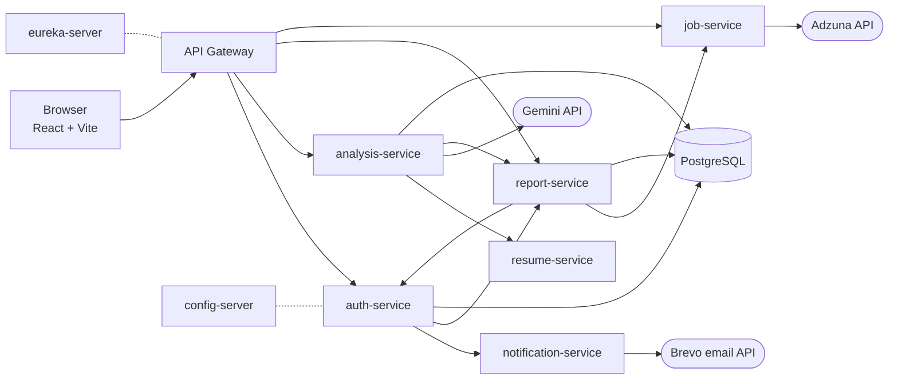

# AI Resume Analyser

An AI-powered resume feedback app. Upload your resume (optionally with a job description) and get an overall score, an ATS-optimisation score, a skills and missing-skills breakdown, and matching job recommendations.

Built as **Spring Boot microservices** behind an API Gateway, with a **React + Vite** frontend.

**Live demo:** https://ai-powered-teal.vercel.app

> The backend runs on free hosting tiers, which put idle services to sleep. The first request after a quiet period can take about a minute while services wake up. See [Free-tier behaviour](#free-tier-behaviour).

---

## Features

- **Sign in with Google** (OAuth2) or **email + password** with OTP email verification
- **Forgot-password** flow with OTP email
- **Resume upload** (PDF, DOC, DOCX, up to 2 MB) with an optional job description
- **AI analysis** with Google Gemini: overall score, ATS-optimisation score, summary, skills, missing skills
- **Live progress**: analysis runs in the background and the page shows its status as it moves along
- **Job recommendations** from the Adzuna API, based on the analysed resume
- **Delete account**: removes the user and their saved report

## Tech stack

| Layer | Technology |
|---|---|
| Frontend | React 19, Vite 7, React Router 7, react-toastify (hosted on Vercel) |
| Backend | Java 17, Spring Boot 3.5, Spring Cloud 2025.0 (Gateway, Netflix Eureka, Config Server, OpenFeign) |
| Security | Spring Security, JWT (HS256), Google OAuth2 |
| Database | PostgreSQL (Spring Data JPA / Hibernate) |
| AI | Google Gemini (`gemini-2.5-flash`) |
| Resume parsing | Apache Tika |
| Email | Brevo transactional email API, Thymeleaf templates |
| Jobs | Adzuna API |
| Build / deploy | Maven, Docker, Render (backend), Vercel (frontend) |

## Architecture



| Service | Port | Responsibility |
|---|---|---|
| `api-gateway` | 8080 | Routing, CORS, JWT pre-check |
| `auth-service` | 8081 | Google login, signup/OTP, password reset, JWT issue and validation, account deletion |
| `resume-service` | 8082 | Extracts text from PDF/DOC/DOCX (Apache Tika) |
| `analysis-service` | 8083 | Creates analysis jobs, runs them in the background, calls Gemini, reports progress |
| `report-service` | 8084 | Stores each user's latest report and attaches job recommendations |
| `job-service` | 8085 | Searches Adzuna, with fallback queries |
| `notification-service` | 8086 | Sends OTP emails through Brevo |
| `eureka-server` | 8761 | Service registry |
| `config-server` | 8888 | Shared configuration (served from `config-repo`) |

Service-to-service calls go directly to each service's public URL (set through environment variables), and each service can start without the Config Server, so a sleeping or slow service doesn't stop the others from booting.

### How an analysis works

1. The browser sends the resume (and optional job description) to `POST /api/analyses` with the user's JWT. The API answers immediately with a job id.
2. In the background, `analysis-service` sends the file to `resume-service`, which extracts the text.
3. `analysis-service` asks Gemini for a structured JSON result: score, ATS-optimisation score, summary, skills and missing skills.
4. The result is saved through `report-service` (one latest report per user).
5. The frontend polls `GET /api/analyses/{id}/status`, then loads `GET /api/reports/latest`. `report-service` adds job recommendations from `job-service`.

### API overview (through the Gateway)

| Method | Path | Purpose |
|---|---|---|
| GET | `/oauth2/authorization/google` | Start Google login |
| POST | `/api/auth/verify-email` | Send signup OTP |
| POST | `/api/auth/register` | Create account with OTP |
| POST | `/api/auth/login` | Email + password login |
| POST | `/api/auth/send-reset-otp`, `/verify-reset-otp`, `/reset-password` | Password reset |
| POST | `/api/auth/validate-token`, `/logout` | Session handling |
| DELETE | `/api/auth/delete-account` | Delete account and report |
| POST | `/api/analyses` | Start an analysis (multipart: `file`, `jobDescription`) |
| GET | `/api/analyses/{id}/status` | Analysis progress |
| GET | `/api/reports/latest` | Latest report with job recommendations |
| POST | `/api/jobs/search` | Job search |

## Project structure

```text
ai-resume-analyser/
├── backend/
│   ├── api-gateway/
│   ├── auth-service/
│   ├── analysis-service/
│   ├── resume-service/
│   ├── report-service/
│   ├── job-service/
│   ├── notification-service/
│   ├── eureka-server/
│   └── config-server/        # config-repo/ holds the shared configuration files
├── frontend/                 # React + Vite app
├── docs/
└── README.md
```

## Configuration

Secrets are never committed. Every service reads its settings from **environment variables**; the names are listed below (values are yours to set).

| Service | Variables |
|---|---|
| `api-gateway` | `JWT_SECRET`, `CORS_ALLOWED_ORIGINS`; optional `AUTH_SERVICE_URL`, `ANALYSIS_SERVICE_URL`, `REPORT_SERVICE_URL`, `JOB_SERVICE_URL`, `EUREKA_SERVER_URL` |
| `auth-service` | `DATABASE_URL`, `DB_USERNAME`, `DB_PASSWORD`, `JWT_SECRET`, `INTERNAL_API_KEY`, `GOOGLE_CLIENT_ID`, `GOOGLE_CLIENT_SECRET`, `FRONTEND_BASE_URL`, `NOTIFICATION_SERVICE_URL`; optional `GATEWAY_PUBLIC_URL` |
| `analysis-service` | `DATABASE_URL`, `DATABASE_USERNAME`, `DATABASE_PASSWORD`, `GEMINI_API_KEY`, `JWT_SECRET`, `INTERNAL_API_KEY`, `RESUME_SERVICE_URL`, `REPORT_SERVICE_URL` |
| `resume-service` | `JWT_SECRET` |
| `report-service` | `DATABASE_URL`, `DATABASE_USERNAME`, `DATABASE_PASSWORD`, `JWT_SECRET`, `INTERNAL_API_KEY`, `JOB_SERVICE_URL` |
| `job-service` | `ADZUNA_APP_ID`, `ADZUNA_APP_KEY`, `JWT_SECRET`; optional `ADZUNA_COUNTRY` (default `gb`) |
| `notification-service` | `BREVO_API_KEY`, `INTERNAL_API_KEY` |
| All services | `CONFIG_SERVER_URL`, `EUREKA_SERVER_URL` (must end with `/eureka/`) |
| Frontend (Vercel) | `VITE_API_URL` (the Gateway's URL); optional `VITE_WARMUP_URLS` (comma-separated health URLs to wake services when the site opens) |

Important:

- `JWT_SECRET` must be **identical** on every service that has it, and at least 32 characters.
- `INTERNAL_API_KEY` must be **identical** on auth, analysis, report and notification services.
- The Gemini, Brevo, Adzuna and Google credentials are your own accounts' keys.

## Run locally

**Prerequisites:** JDK 17, Maven 3.9+, Node 20+, a local PostgreSQL database.

1. **Create a database** and set the variables above for each service (for example in your shell or IDE run configuration).
2. **Point the Gateway at local services**, because its defaults are the deployed URLs:

   ```text
   AUTH_SERVICE_URL=http://localhost:8081
   ANALYSIS_SERVICE_URL=http://localhost:8083
   REPORT_SERVICE_URL=http://localhost:8084
   JOB_SERVICE_URL=http://localhost:8085
   RESUME_SERVICE_URL=http://localhost:8082
   NOTIFICATION_SERVICE_URL=http://localhost:8086
   ```

3. **Start the services** (each in its own terminal). Eureka and the Config Server are optional locally: services start without them and only log warnings.

   ```bash
   cd backend/<service>
   mvn spring-boot:run
   ```

4. **Start the frontend:**

   ```bash
   cd frontend
   echo VITE_API_URL=http://localhost:8080 > .env
   npm install
   npm run dev
   ```

   The app opens at http://localhost:5173 (already allowed by the Gateway's default CORS setting).

For Google login locally, add `http://localhost:8080/login/oauth2/code/google` as an authorised redirect URI in Google Cloud Console and set `GATEWAY_PUBLIC_URL=http://localhost:8080` and `FRONTEND_BASE_URL=http://localhost:5173` on `auth-service`.

> `docker-compose.yml` and `docs/microservices-migration-design.md` come from an earlier stage of the project (the compose file is written for MySQL). They don't describe the deployed setup.

## Deployment

**Backend (Render, one Docker web service per module)**

- Root Directory: `backend/<service>`; the service's own `Dockerfile` is used.
- Health Check Path: `/actuator/health/liveness` (use `/actuator/health` for `notification-service`).
- Set the environment variables from the table above.
- The Dockerfiles download Maven dependencies from Google's Maven Central mirror, because Maven Central rate-limits shared build servers (HTTP 429).
- Deploy a few services at a time, not all at once.

**Frontend (Vercel)**

- Root Directory: `frontend`, framework preset: Vite.
- Environment variable `VITE_API_URL` = the API Gateway's public URL.
- Add that Vercel domain (and the deployment-URL pattern for the project) to `CORS_ALLOWED_ORIGINS` on the Gateway.

## Free-tier behaviour

- Render **spins down free services after 15 minutes without traffic**, and waking one takes about a minute. The services retry calls to a sleeping service for a couple of minutes, and the frontend sends background requests on page load to wake the ones the sign-in flow needs.
- All free services in a Render workspace **share 750 instance hours per month**.
- A free Render Postgres database **expires 30 days after creation** unless upgraded.

## Known limitations

- `PreviousTable.email` is the primary key, so only the **latest report per user** is kept (no report history).
- Only Google is configured for social login.
- `report-service`'s calls to `auth-service` still go through Eureka lookup by name; they only mark that a user has a previous result.
- There is no automated test suite yet.

## Author

**Rohith R Gowda** — Java Full Stack Developer

- GitHub: [Rohithrgowda23](https://github.com/Rohithrgowda23)
- LinkedIn: [rohithrgowda](https://linkedin.com/in/rohithrgowda)
